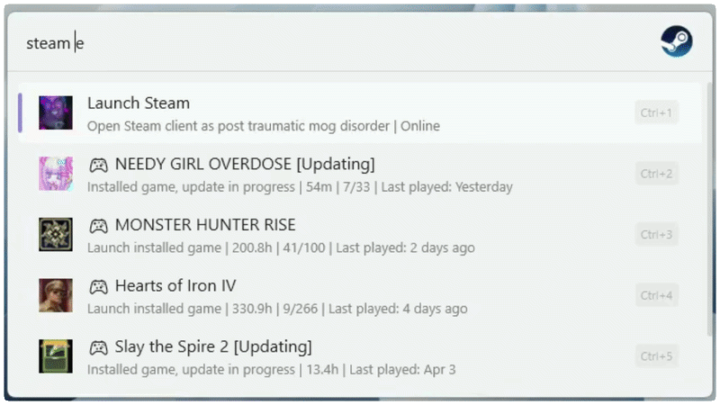
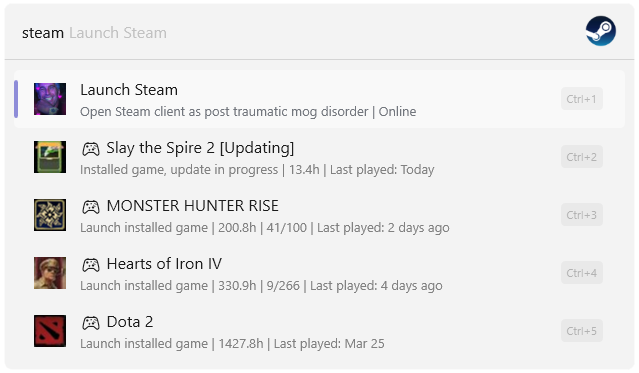
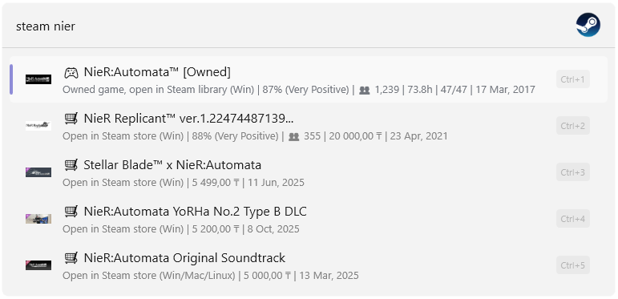
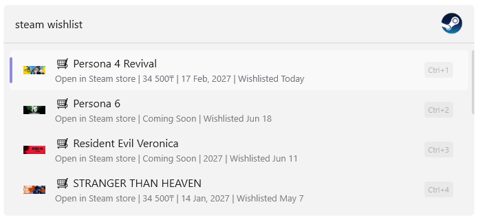
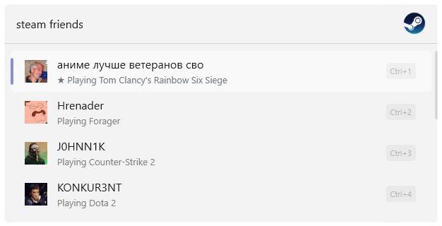
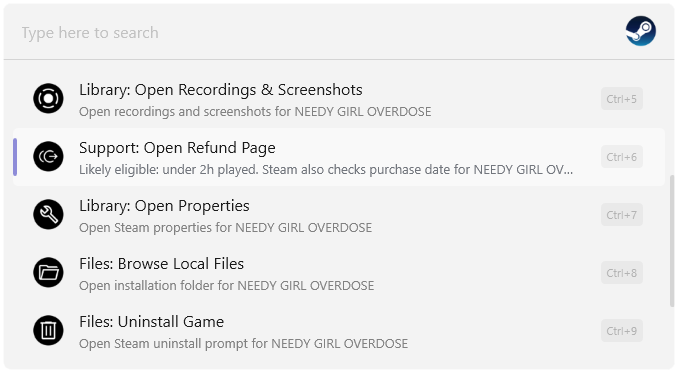
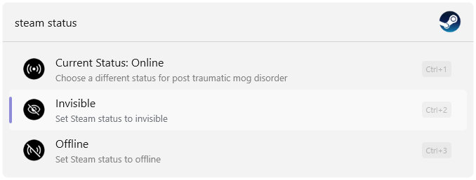
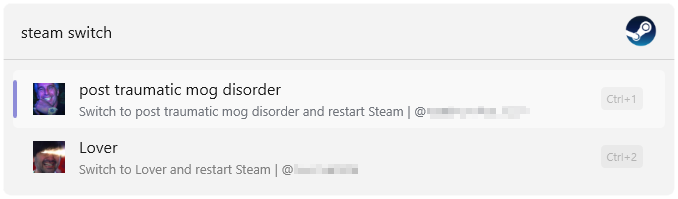

  <picture>
    <source media="(prefers-color-scheme: dark)" srcset=".github/ico_for_dark.svg">
    <source media="(prefers-color-scheme: light)" srcset=".github/ico_for_light.svg">
    
  </picture>

  
  
  
  

## SteamFlow: Steam plugin for [Flow Launcher](https://www.flowlauncher.com/)

### Search Steam store, launch games & more

### Commands

`steam ?`
`steam api`
`steam top`
`steam deals`
`steam status`
`steam switch`
`steam friends`
`steam wishlist`

## Features

### Local library

- Launch installed games directly from Flow Launcher
- Shows playtime, last played date & achievement progress
- Display game update status & control downloads (pause/resume updates)
- Sorted by most recently played

### Steam Store search

- Search the Steam store by game name
- Shows review score, concurrent player count, price & release date
- Shows which friends are currently playing a game
- Browse Steam top sellers (`steam top`) & specials (`steam deals`)
- Owned games opens directly in your library

### Wishlist

- Browse & search your Steam wishlist
- Shows current price, review score & date added to wishlist
- Requires a Steam Web API key (`steam api` to configure)

### Friends

- Browse & search friends (`steam friends`)
- Pins Steam favorite friends to the top of the list
- Context menu: open chat, profile, trade offer, game page, or join their game when available
- Requires a Steam Web API key (`steam api` to configure)

### Smart context menu

- Open store page in Steam/[SteamDB](https://steamdb.info/)
- Search game topics on [CS.RIN](https://cs.rin.ru/forum/viewforum.php?f=10) (off by default)
- Show the [ProtonDB](https://www.protondb.com/) rating for Linux/Steam Deck (off by default)
- Open community guides & discussions
- Open recordings & screenshots folder
- Open game properties
- Browse local game files
- Check refund eligibility
- Add games to Steam shopping cart
- Add/remove games from Steam wishlist
- Join a friend currently playing the game
- [SmokeAPI](https://github.com/acidicoala/SmokeAPI)(experimental, off by default, may break games)
- Install/uninstall game

### Steam status

- Switch to online/invisible/offline in one click

### Account switcher

- Switch between Steam accounts signed in on this PC & restart Steam instantly

### Steam Web API

> API key is encrypted & bound to active Steam account

- Detects owned games from store search
- Enables wishlist browsing
- Enables friend list, favorites & join-game actions
- Shows your active profile status

## Installation

Type `pm install SteamFlow by keekys` in Flow Launcher

## Check out my other plugins

- [GoogleKeepFlow](https://github.com/keekyslusus/GoogleKeepFlow)
- [GrepFlow](https://github.com/keekyslusus/GrepFlow)
